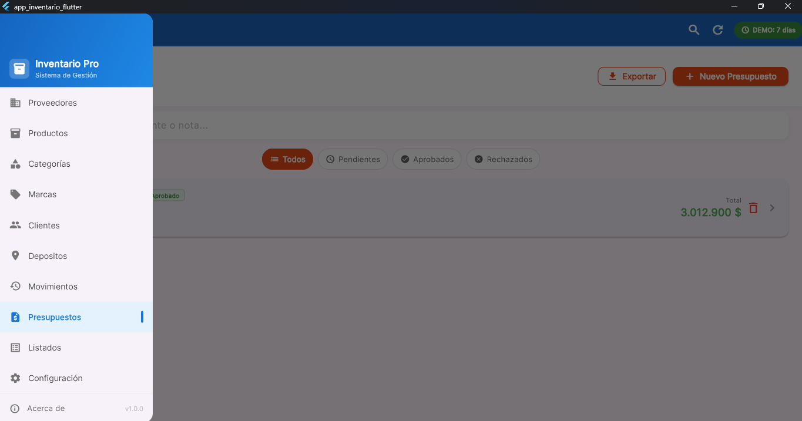
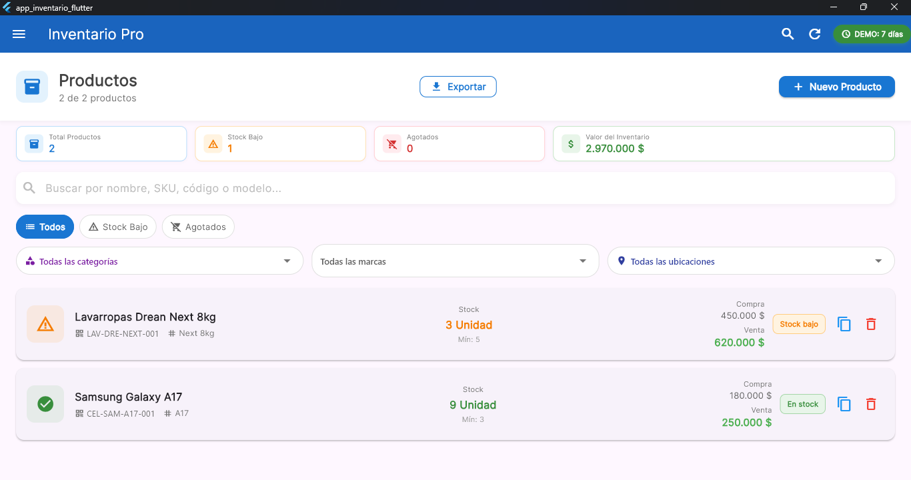
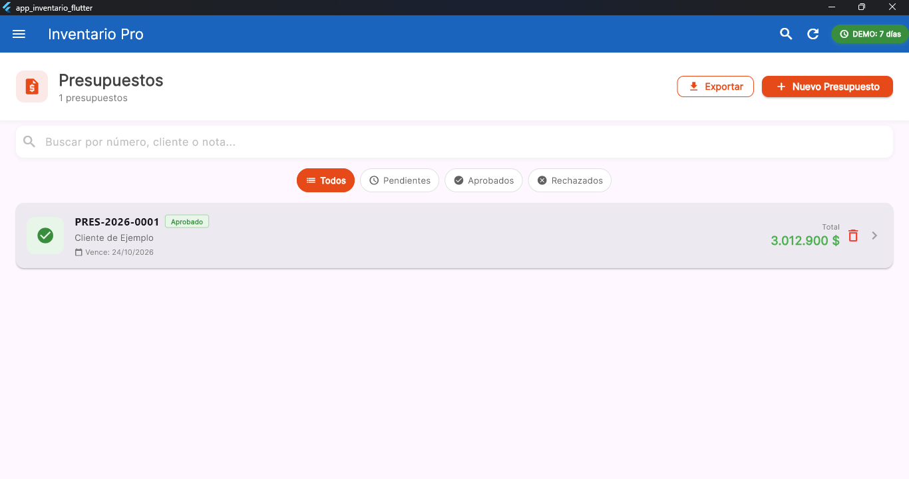
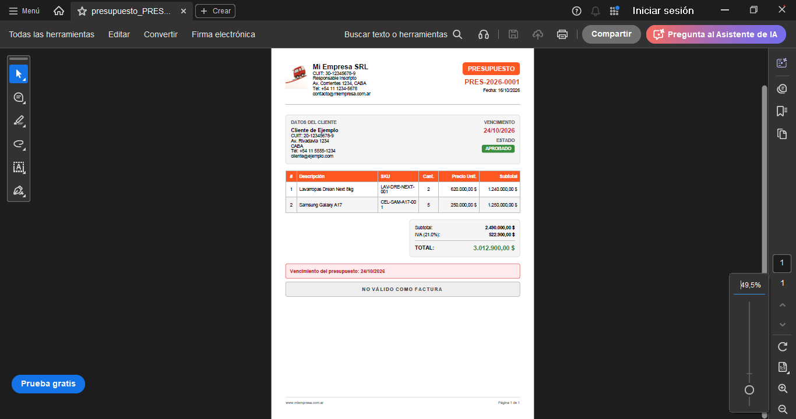

# 📦 Inventario Pro

Sistema de gestión de inventario para PYMEs desarrollado en Flutter para Windows.

---

## 📋 Descripción

**Inventario Pro** es una aplicación de escritorio completa para la gestión de inventario de pequeñas y medianas empresas. Permite administrar productos, proveedores, clientes, presupuestos y movimientos de stock, con generación de reportes y exportación a PDF/CSV.

### ✨ Características principales

- 📊 **Gestión de inventario:** productos con stock, precios, categorías, marcas y ubicaciones
- 👥 **Administración de terceros:** proveedores y clientes con datos completos
- 📝 **Presupuestos profesionales:** generación de PDF con logo de la empresa
- 📈 **Movimientos de stock:** entradas, salidas y ajustes con historial
- 📑 **Reportes y estadísticas:** dashboard con 9 reportes exportables
- 💾 **Backup automático:** copias de seguridad diarias con rotación
- 📤 **Exportación:** CSV y PDF en todos los módulos
- 🔒 **Modo Demo:** 7 días de prueba con bloqueo automático

---

## 🖥️ Capturas de Pantalla

Menu 

Dashboard 

Productos 

Presupuestos 

PDF 

## 🚀 Instalación

### Requisitos

- **Windows 10** o superior
- **Visual Studio 2019** o superior (con C++ Desktop Development)
- **Flutter SDK** 3.44.1 o superior

### 🛠️ Tecnologías Utilizadas

- Flutter 3.44.1	Framework de UI
- Dart 3.12.1	Lenguaje
- SQLite (sqflite_common_ffi)	Base de datos local
- Provider	Gestión de estado
- pdf + printing	Generación de PDFs
- csv	Exportación a CSV
- file_picker	Selector de archivos
- window_manager	Control de ventana nativa
- shared_preferences	Configuración local
- intl	Formateo de fechas y monedas

## 🎯 Funcionalidades por Módulo

### 📦 Productos
CRUD completo con validaciones

Gestión de stock con alertas (bajo/agotado)

Precios de compra/venta con cálculo de margen

Duplicación de productos

Historial de precios con notas

Filtros por categoría, marca, ubicación y estado

### 👥 Proveedores y Clientes
CRUD con datos completos (CUIT, contacto, dirección)

Búsqueda por cualquier campo

Exportación a CSV/PDF

### 🏷️ Categorías, Marcas y Ubicaciones
CRUD con jerarquía (categorías)

Vista de productos asociados

Navegación directa al producto

### 📊 Movimientos
Registro de entradas, salidas y ajustes

Actualización automática de stock

Historial completo con filtros

Vista previa del impacto en stock

### 📝 Presupuestos
Carrito de productos con cantidades editables

Cálculo automático de subtotal, IVA y total

Estados (pendiente, aprobado, rechazado)

Generación de PDF profesional

Numeración automática (PRES-2026-0001)

### 📈 Listados y Reportes
Dashboard con estadísticas generales

9 reportes exportables:

Stock bajo / Agotados

Top productos movidos

Por categoría / proveedor

Top marcas / categorías / ubicaciones

Historial completo

### 💾 Backup y Configuración
Configuración de datos de la empresa

Logo personalizado para PDFs

Backup automático diario (últimos 7)

Restauración desde cualquier backup

## 🔐 Modo Demo

La aplicación incluye un modo demo de 7 días para distribución comercial:

DEMO: flutter build windows --release --dart-define=IS_DEMO=true

FULL: flutter build windows --release --dart-define=IS_DEMO=false

### Características del modo demo

✅ Funciona por 7 días completos

✅ Contador visible en la barra superior

✅ Aviso en los últimos 3 días

✅ Bloqueo automático al día 8

✅ Los datos NO se borran (si se compra la licencia)

❌ Sin botón de reset en modo producción

📞 Contacto y Licencias
Para comprar la licencia:
📧 Email: adrj67@gmail.com

📱 Teléfono: +54 223 400-1010

### Soporte técnico
Para reportar bugs o sugerencias, abrí un issue.

## 📄 Licencia
Este proyecto es de uso comercial. Todos los derechos reservados.

No se permite la redistribución, modificación o uso comercial sin autorización expresa del autor.

## 🙏 Agradecimientos

Flutter Team por el framework

Comunidad de Flutter por los paquetes open source

Argentina Programa por el espacio de aprendizaje

Deep Seek por la ayuda y el asesoramento.

